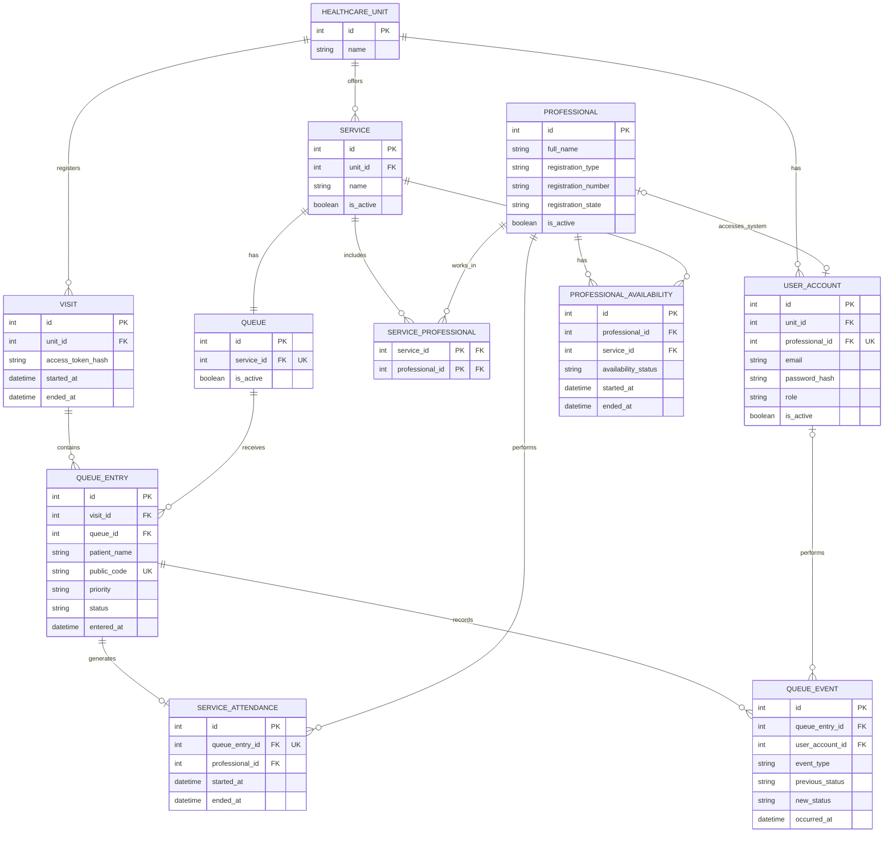

# Database Design — Entity-Relationship Diagram (ERD)

## 1. Overview

This document presents the initial database design for the **Queue Management System for Brazil's Unified Health System (SUS)**.

The system organizes healthcare queues by service within each healthcare unit. It supports temporary patient visits, professional availability, queue operations, and operational records.

The database will use **PostgreSQL** as its relational database management system.

## 2. Entity-Relationship Diagram

## 3. Business Rules and Constraints

- Each healthcare unit can offer multiple services.
- Each service has one queue within its healthcare unit.
- Each queue entry belongs to one temporary visit and one service queue.
- A visit can have multiple queue entries over time, but only one active entry at a time.
- A patient must finish or leave the current queue before entering another queue during the same visit.
- Patient names are stored in queue entries; no permanent patient account is required.
- Public queue displays must use anonymous identifiers rather than patient names.
- Preferential priority must be assigned or validated by an authorized professional.
- Multiple professionals can work in the same service, and a professional can be associated with multiple services.
- Only authorized user accounts can perform restricted operational actions.
- Passwords must be stored as secure hashes, never as plain text.
- Queue events record relevant operational changes, including status transitions.
- A queue entry can generate at most one service attendance record.

## 4. Important Implementation Constraints

The following rules must also be enforced when implementing the database:

- A unique constraint must ensure that each service has only one queue.
- A partial unique index must prevent a visit from having more than one active queue entry.
- The service associated with a queue entry must belong to the same healthcare unit as its visit.
- A professional's availability for a service must respect their association with that service.
- Access tokens must be unpredictable; only their hashes should be stored.
- Operational records must follow an appropriate data-retention policy.

---

# Modelagem do Banco de Dados — Diagrama Entidade-Relacionamento (DER)

## 1. Visão Geral

Este documento apresenta a modelagem inicial do banco de dados do **Sistema de Gerenciamento de Filas para o Sistema Único de Saúde (SUS)**.

O sistema organiza filas por serviço dentro de cada unidade de saúde. Ele contempla visitas temporárias de pacientes, disponibilidade dos profissionais, operações das filas e registros operacionais.

O banco de dados utilizará **PostgreSQL** como sistema gerenciador de banco de dados relacional.

## 2. Diagrama Entidade-Relacionamento

O diagrama apresentado na seção anterior representa o modelo conceitual e lógico inicial do sistema. Os nomes das entidades e atributos foram mantidos em inglês para padronização com a implementação.

## 3. Regras de Negócio

- Cada unidade de saúde pode oferecer diversos serviços.
- Cada serviço possui uma fila dentro de sua unidade de saúde.
- Cada entrada de fila pertence a uma visita temporária e a uma fila de serviço.
- Uma visita pode possuir várias entradas de fila ao longo do tempo, mas apenas uma entrada ativa por vez.
- O paciente deve finalizar ou sair da fila atual antes de entrar em outra durante a mesma visita.
- O nome do paciente é armazenado diretamente na entrada da fila; não é necessário manter um cadastro permanente de pacientes.
- Os painéis públicos devem utilizar identificadores anônimos, sem exibir os nomes dos pacientes.
- A prioridade preferencial deve ser atribuída ou validada por um profissional autorizado.
- Vários profissionais podem trabalhar no mesmo serviço, e um profissional pode estar associado a vários serviços.
- Somente contas de usuários autorizados podem executar operações restritas do sistema.
- As senhas devem ser armazenadas como hashes seguros, nunca em texto puro.
- Os eventos da fila registram alterações operacionais relevantes, incluindo mudanças de status.
- Cada entrada de fila pode gerar, no máximo, um registro de atendimento.

## 4. Restrições Importantes para a Implementação

As seguintes regras também deverão ser garantidas durante a implementação do banco de dados:

- Uma restrição de unicidade deverá garantir que cada serviço possua apenas uma fila.
- Um índice único parcial deverá impedir que uma visita possua mais de uma entrada de fila ativa.
- O serviço associado a uma entrada de fila deverá pertencer à mesma unidade de saúde da visita.
- A disponibilidade de um profissional em determinado serviço deverá respeitar sua associação com esse serviço.
- Os tokens de acesso deverão ser imprevisíveis; somente seus hashes deverão ser armazenados.
- Os registros operacionais deverão seguir uma política adequada de retenção de dados.
